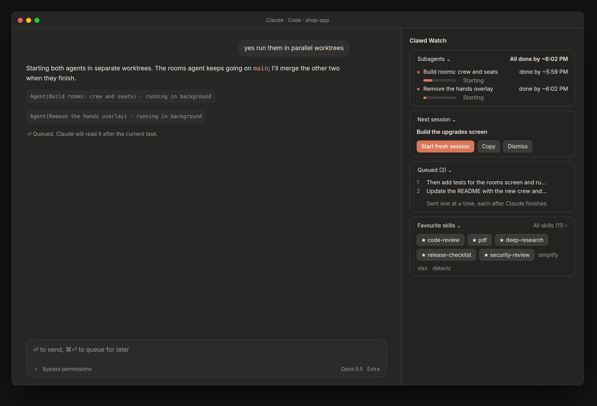
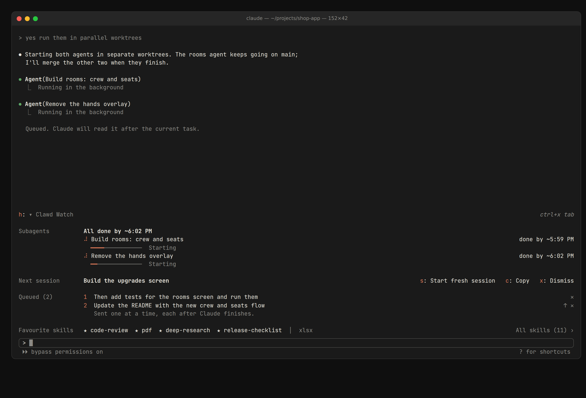

# Clawd Watch

[](LICENSE)

Clawd Watch keeps an eye on Claude Code while it works: see when your subagents will finish, queue messages for after Claude is done, start the next piece of work in a fresh session with one click, and keep your favourite skills one click away.

*A community project: not made by or affiliated with Anthropic.*



| Section | What it shows |
| --- | --- |
| [Subagents](#subagents-and-the-next-session) | When your subagents will finish, and what each is doing |
| [Next session](#subagents-and-the-next-session) | A one-click handoff to a fresh session |
| [Queued](#the-queue) | Messages that wait until Claude finishes, instead of steering the current task |
| [Favourite skills](#favourite-skills) | Your pinned and most-used skills, and every skill, searchable |

### The panel

**In the desktop app** Clawd Watch is a panel in the sidebar, beside the conversation, made of cards like the app's own. Click a card's title to collapse it, and again to open it; cards stay the way you left them.

- The panel opens when the desktop app does. Close it with its close mark or `/watch`, and it stays closed in later sessions until you open it again.
- While it's closed, one line above the prompt says what's going on (*2 subagents running · 1 queued*). **Open panel** brings it back, and so does `/watch`.
- Where the app can't place a side panel, everything shows above the prompt instead.

**In the terminal** the same sections sit above the prompt, drawn in text (see [Where it works](#where-it-works)). Click **▾ Clawd Watch** (or press `h` after `ctrl+x tab`) to fold them to one line; it stays folded in new sessions. In the fullscreen layout, `/watch` docks the panel on the right instead.

## Install

**Requirements:** a Claude Code build with mods (plugins of function hooks). Clawd Watch was built against Claude Code 2.1.288. The mods API is in early access and may change between releases.

### With Claude

Paste this into Claude Code:

```
Install Clawd Watch for me: clone https://github.com/Vansitha/clawd-watch into ~/.claude/mods/clawd-watch and follow the INSTALL.md inside it.
```

Claude asks whether you want Clawd Watch in the desktop app, the terminal or both. Then it clones the repo, runs the installer (or does the same by hand on Windows), checks the plugin, and tells you what to do next. It also asks before changing any keys. The steps it follows are in [INSTALL.md](INSTALL.md).

### By hand (macOS or Linux)

```sh
git clone https://github.com/Vansitha/clawd-watch.git ~/.claude/mods/clawd-watch
~/.claude/mods/clawd-watch/install.sh
```

The installer asks where Clawd Watch should run: the desktop app and the terminal, the desktop app only, or the terminal only. Skip the question with `--only desktop`, `--only terminal` or `--only both`.

Then quit and reopen the Claude desktop app, or start a new `claude` session. Type `/` in the prompt: `/watch`, `/dock`, `/queue` and `/handoff` should be in the list.

The installer adds the clone to `CLAUDE_CODE_PLUGIN_DIRS` in `~/.claude/settings.json` and keeps everything else there. It saves the old file as `settings.json.bak`, then checks the plugin. Run it again any time to update.

| To | Run |
| --- | --- |
| Update | `~/.claude/mods/clawd-watch/install.sh` (it pulls the latest version first and keeps your choices) |
| Change where it runs | `~/.claude/mods/clawd-watch/install.sh --only desktop` (or `terminal`, `both`), or **Show in** under `/config` |
| Uninstall | `~/.claude/mods/clawd-watch/install.sh --uninstall` |
| Try it in one terminal session without changing your settings | `claude --plugin-dir ~/.claude/mods/clawd-watch` |

On Windows, follow [INSTALL.md](INSTALL.md) step 3b, or ask Claude to.

Used the three separate mods (session-hud, message-queue and skill-dock), or installed it when it was called claude-mods or Overwatch? Run the installer as above. It replaces the old mods in your settings and keeps your **Show in** choice, and on its first start Clawd Watch takes over your pins, skill history, hidden skills and subagent timings. If an old clone sits in a folder of its own (`~/.claude/mods/claude-mods` or `~/.claude/mods/overwatch`), delete it.

## Subagents and the next session

```
Subagents     All done by ~5:59 PM
              ● Build rooms: crew and seats            done by ~5:57 PM
                ━━━━━━━──────────  Reading crew-tokens.ts
              ● Remove the hands overlay               done by ~5:59 PM
                ━━━──────────────  Editing Hand.tsx
Next session  Build the upgrades screen         [Start fresh session] [Copy] [Dismiss]
```

**Subagents.** While subagents run, the header says when they'll all be done. Each agent shows when it will be done, a progress bar, and what it's doing right now.

Claude Code doesn't report real progress for subagents, so these are estimates. When a subagent starts, a small, fast model (Haiku) reads its task and guesses how many minutes and tool calls it needs; the row says *estimating…* for the second or two that takes. Each finished run is compared with its guess, and later guesses are scaled to match how long your subagents really take. Clawd Watch remembers this across sessions, so estimates improve the more you use it. If the guess can't be made, the estimate falls back to how long past subagents of the same type took. Sizing costs one short Haiku call per subagent.

**Handoff to a fresh session.** **Start fresh session** clears the conversation and sends a starter prompt for the next piece of work, so you don't have to write one. The prompt is also copied to your clipboard.

- `/handoff` writes the starter prompt on demand. Add a focus if you like: `/handoff the payments refactor`.
- Every few turns, sooner once the context passes 30%, Clawd Watch asks Claude whether the next piece of work would go better in a fresh session. When it would, the section appears on its own as **Suggested**, with the reason. If you don't use it, it clears itself after 3 more turns.
- `/handoff auto off` and `/handoff auto on` turn the automatic suggestions off or on.

## The queue

```
Queued (2)    1  Then add tests for the rooms screen and run them                   ✕
              2  Update the README with the new crew and seats flow               ↑ ✕
                 Sent one at a time, each after Claude finishes.
```

Queue a message for Claude to read **after** it finishes what it's doing, instead of steering the task it's on.

- **Enter** works as always: a message typed while Claude works steers the current task.
- **The queue key** holds the message instead, and Claude reads it once the current task ends. This is Claude Code's `chat:queueSubmit`, `ctrl+x enter` by default.
- **`/queue <message>`** does the same from the prompt, and works everywhere, the desktop app included. `/queue clear` empties the queue.
- Queued messages go one at a time, in order, each after the previous task finishes. **↑** moves one up and **✕** removes it.
- If you stop Claude with Esc, the queue pauses so it doesn't start the next task without you. Press **Send next** when you're ready.
- Messages with images can't be queued, so they're sent right away.

### Queue with Cmd+Enter

Add this to `~/.claude/keybindings.json`, merging it with anything already there:

```json
{
  "$schema": "https://www.schemastore.org/claude-code-keybindings.json",
  "$docs": "https://code.claude.com/docs/en/keybindings",
  "bindings": [
    { "context": "Chat", "bindings": { "cmd+enter": "chat:queueSubmit" } }
  ]
}
```

Cmd+Enter then queues, and Shift+Enter still starts a new line. The terminal only sees Cmd if it reports it (kitty and Ghostty do; Terminal.app and many others don't). Where it doesn't, `ctrl+x enter` and `/queue <message>` always work. Newer desktop apps already queue with ⌘⏎ (the prompt says *⌘⏎ to queue for later*).

## Favourite skills

```
Favourite skills  ★ code-review  ★ pdf  ★ deep-research  │  simplify  xlsx      All skills (12) ›
```

Your pinned skills and your most-used ones, one click away.

- **Click a skill** to put `/skill-name` at the front of the prompt box, keeping anything you'd already typed. Add details and press Enter.
- **★ Pinned skills** come first, then your most-used ones. In the desktop app every pin shows, wrapping onto a second row if needed; the terminal shows as many as fit one row. "Most used" counts how often you used each skill in the last 30 days, whether you typed `/name` or Claude loaded it.
- **All skills ›** (or `/dock`) turns the panel to every skill, in three lists (**‹ Back** returns):
  - **Pinned**
  - **Most used:** your top 10
  - **Available here:** every skill you can use in this project, A to Z

  Click ☆ to pin a skill, or click a name to use it. Where the app can't show a side panel, the lists open above the prompt instead.
- **Search and filter** at the top of the list. Each skill is tagged by where it comes from, and the filters show each kind with a count:
  - **Built-in:** comes with Claude Code
  - **Mine:** skills you wrote, in `~/.claude/skills` or the project's `.claude/skills`
  - **Installed:** from a plugin, an MCP server, or `npx skills add`; the tag says which one (for example `pbakaus/impeccable`)
- **Remove or hide a skill** from its row (hover it in the desktop app):
  - **Remove** takes one of your own skills out of Claude Code, after you confirm. Nothing is deleted: it moves to `~/.claude/clawd-watch/removed-skills`, and moving it back restores it. Run `/reload-skills` to drop it from the `/` menu straight away.
  - **Hide** is for skills that come with Claude Code or a plugin, which can't be removed one at a time. They leave the dock and the lists but still work if you type them. The **Hidden** filter lists them, with **Unhide**.
- `/dock pin <skill>`, `/dock unpin <skill>`, `/dock hide <skill>` and `/dock unhide <skill>` do the same from the prompt.
- In the `/` menu, pinned skills say `★ pinned` and used ones say how often you used them in the last 30 days.

Built-in skills such as `simplify` look like ordinary commands until you use them once. After that they show up in the lists.

## Where it works



In the terminal, the same panel is drawn in text:

- **Controls are text.** Buttons read like `s: Start fresh session`, and skills are a plain list rather than boxed chips.
- **Clicking works in the fullscreen layout.** Otherwise, press `ctrl+x tab` to move into the panel (the panel shows this hint), then use Tab and Enter, or the letter before a button. Esc returns to the prompt.
- **Narrow windows are handled.** Under 72 columns, each section's name moves above its content so nothing gets squeezed.
- **The panel** stays above the prompt; in the fullscreen layout `/watch` docks it on the right.

Clawd Watch has a **Show in** setting (both, desktop or terminal), under `/config` or set by the installer. Switched off for a surface, it draws nothing there and stays out of the way. It still counts the skills you use there, so your lists stay right.

- **Claude desktop app, Code tab** (local sessions): everything, in a sidebar panel of cards with native buttons and rounded progress bars.
- **Terminal** (`claude`): everything, drawn in text as above.
- **VS Code extension and mobile:** Claude Code doesn't draw the panel above the prompt there, so nothing shows. The slash commands still work.
- **Cloud sessions** run on a remote machine, so Clawd Watch would need to be installed there, not on your computer.

## Develop

The repo is the plugin: a manifest (`.claude-plugin/plugin.json`), a state contract (`types/index.d.ts`), tests (`tests/`) and the hooks module (`hooks/`):

| File | What it holds |
| --- | --- |
| `hooks/register.tsx` | The entry: the panel above the prompt and in the sidebar, `/watch`, and taking over the old mods' saved data |
| `hooks/subagents.tsx` | Subagents, their estimates, and the handoff to a fresh session |
| `hooks/queue.tsx` | The queue |
| `hooks/skills.tsx` | Favourite skills and the skills list |
| `hooks/pane.tsx`, `hooks/shared.tsx` | The sidebar pane, and what every section shares (cards, layout, Show in) |

```sh
claude plugin validate . && claude plugin test .
```

`tests/install.test.sh` checks the installer: it runs both of its settings editors (Node and Python) on the same awkward `settings.json` files and checks they agree.

```sh
bash tests/install.test.sh
```

Load it with `claude --plugin-dir .` while you work on it: it reloads whenever you save.

Issues and pull requests are welcome.

## License

[MIT](LICENSE)
